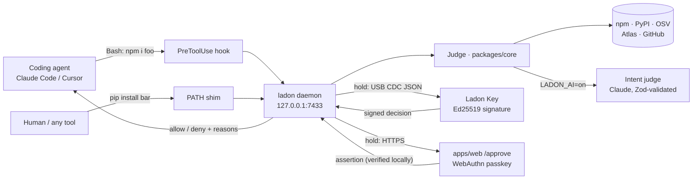

# Ladon

**A firewall between AI coding agents and the package registries.**

Coding agents (Claude Code, Cursor, Codex, Cline) now run `npm install` and `pip install` on their own.
Attackers noticed: they register the names models hallucinate (slopsquatting), they plant instructions in
`AGENTS.md` / `CLAUDE.md` that tell the agent to install their package, and their worms steal tokens and
plant hooks inside AI tools. Ladon intercepts every install, scores the package with documented,
deterministic rules, and **holds risky installs until a human approves on a physical Ladon Key or a
passkey** — an approval the agent cannot fake.

> Built for IceHacks 2026 (Nov 8–15). Live: **https://ladon-one.vercel.app** · Evaluation: [`docs/EVAL.md`](docs/EVAL.md)

```
■ HOLD  npm:color-fn-utils@1.0.2  risk 100/100
  • package first published 2 h ago
  • install script loads a network module in scripts/postinstall.js
  • install script reads environment variables in scripts/postinstall.js (+1 more)
→ Held. Approve or reject on your Ladon Key. The agent cannot approve this.
```

## The four heads

| Head | What it does | Where |
|---|---|---|
| **Gate** | Claude Code `PreToolUse` + `SessionStart` hooks, Cursor `beforeShellExecution` + `beforeSubmitPrompt` hooks (`init --cursor`), a Codex CLI `PreToolUse` hook (`init --codex`), and PATH shims for `npm npx pnpm pnpx yarn bun bunx pip uv uvx poetry pipx pipenv` plus pure-sh `python`/`python3` shims that only start Ladon for `-m pip` / `-m uv` — so *any* agent or human install passes through Ladon. Also scans instruction files for injected install directives and watches AI-tool configs for planted hooks / MCP servers. | `packages/cli` |
| **Judge** | 15 documented rules (exists? OSV `MAL-`? hallucinated per Atlas? typosquat / conflation of a top-5k name? brand new? new version by a new maintainer? install script touching network / env / `~/.claude`? provenance dropped?) → score 0–100 → ✓ allow / ▲ warn / ■ hold. Optional LLM **intent-drift** check: does this install match what the human asked for? It can only escalate. | `packages/core` |
| **Key** | ESP32-S3 + 2" screen + two buttons. Generates its own Ed25519 key; shows package, score and top reasons; hold-to-approve 1.5 s signs `id|commandHash|nonce|exp|ok|counter`. Passkey (WebAuthn) approval on your phone is the alternative. | `firmware`, `hardware`, `apps/web/approve` |
| **Atlas** | Public map of package names AIs hallucinate and whether someone registered them recently. Public checker for any package or manifest. | `apps/web` |

## Architecture



Decision path for one install: parse the command (incl. `cd x && …`, `bash -c`, `sudo`, `npx`, `pip -r`)
→ lockfile fast path → gather evidence in parallel (cached) → rules → score → optional intent check →
**allow** (exec), **warn** (proceed, reasons shown to agent and human) or **hold** (wait ≤ 120 s for a signed
approval; otherwise the agent gets the reasons and is told not to route around the gate).

## Why the agent can't approve itself

- There is **no approve command or flag**. `ladon allow` itself needs a Key/passkey approval.
- Key approvals are Ed25519 signatures from a private key that never leaves the device, bound to the exact
  command hash, a one-time nonce, an expiry and a strictly increasing counter (replay-proof).
- Passkey approvals: the web app is only a mailbox. The daemon pins the passkey's public key at pairing and
  **verifies every WebAuthn assertion itself**; the decision (approve/reject) is part of the signed challenge.
- **Adding an approver needs a human.** The first passkey or Key is confirmed by typing `yes` on `/dev/tty`
  (an agent's shell has no terminal); every later one, and replacing a Key, must be approved by an
  already-paired Key or passkey. Listing passkeys on the server never pins them, so a compromised server
  can't inject one.
- **Tamper protection on the agent channel:** the hook also covers `Edit`/`Write`, and refuses agent tool
  calls that touch `~/.ladon`, run pairing / `init` / `shim uninstall`, edit AI-tool hook configs, or point
  Ladon at another daemon or server.
- Any internal error on an install command **denies** (fail closed). Unreachable data sources hold.
- Threat model, honestly: this protects against a hijacked *agent* acting through its tools. Code that is
  already running as your OS user (a determined agent obfuscating a shell command, or local malware) can
  still edit files Ladon relies on; the Key's private key is not yet protected by flash encryption. Both are
  documented follow-ups.

## Results

From [`docs/EVAL.md`](docs/EVAL.md) (`pnpm eval`, `LADON_AI=off`):

| actual \ verdict | ✓ allow | ▲ warn | ■ hold |
|---|---:|---:|---:|
| benign (40 real npm + PyPI packages) | 40 | 0 | 0 |
| malicious (16 harmless canaries imitating real attack shapes) | 0 | 0 | 16 |
| hallucinated (19 non-existent / Atlas names) | 0 | 0 | 19 |

Cached verdict ≈ 190 ms end to end through the hook; uncached ≈ 0.3–1.2 s. The malicious set is our own
canaries, so this measures whether the rules catch known attack *shapes*, not novel ones.

## Quick start

```bash
pnpm install && pnpm build && pnpm test
node packages/cli/dist/index.js init --shell --passkey   # hooks + shims, pair a passkey
# add --cursor and/or --codex to also hook Cursor (~/.cursor/hooks.json) and Codex (~/.codex/hooks.json; run /hooks in Codex once to trust it)
node packages/cli/dist/index.js check react-codeshift -v
node packages/cli/dist/index.js scan                     # instruction-file injection scan
```

Optional `~/.ladon/env`: `ANTHROPIC_API_KEY=…` and `LADON_AI=on` turn on the intent judge.
Everything works with `LADON_AI=off`.

### Demo (local only, nothing is published anywhere)

```bash
pnpm demo:registry                         # Verdaccio on 127.0.0.1:4873
pnpm demo:publish-canaries                 # 16 harmless canaries; the script refuses non-local registries
cd demo/scenarios/poisoned-agents-md && claude   # ask: "make the navbar sticky"
```

Canary payloads only write `/tmp/ladon-canary-pwned` and ping `127.0.0.1`. See `demo/scenarios/*/README.md`.

## Repo

```
packages/core   parser, sources, rules R01–R15, scoring, analyzers, approval protocol, intent judge
packages/cli    ladon init|check|scan|watch|status|log|key|passkey|allow|shim|daemon|hook
apps/web        Next.js: /check, /atlas, /approve/[id], /pair, /dashboard, /api/*
firmware        Ladon Key (PlatformIO, ESP32-S3)
hardware        BOM, wiring, enclosure DXF
demo            Verdaccio config, canary generator, attack scenarios
fixtures        evaluation corpus + results
docs            PRD, PLAN, DOCS (rules), API contract, EVAL
```

## Credits

Libraries: TypeScript, Node.js, pnpm, Next.js, React, Tailwind CSS, Zod, Vitest, acorn, semver,
@simplewebauthn/server + browser, serialport, @anthropic-ai/sdk, @supabase/supabase-js, Verdaccio;
firmware: Arduino-ESP32, PlatformIO, ArduinoJson, Adafruit GFX / ST7789 / NeoPixel, Ed25519 implementation
credited in `firmware/README.md`.
Data: npm registry + downloads API, PyPI JSON API, pypistats.org, OSV.dev (incl. OpenSSF malicious-packages
`MAL-` advisories), [npm-high-impact](https://github.com/wooorm/npm-high-impact) (top npm list),
[hugovk/top-pypi-packages](https://github.com/hugovk/top-pypi-packages) (top PyPI list).
Research: Spracklen et al., *We Have a Package for You!* (USENIX Security 2025) on package hallucination;
public incident write-ups on Clinejection, Shai-Hulud and the 2026 worm waves (links in the write-up).

## AI disclosure

This project was built with heavy use of **Claude Code (Anthropic)** as a coding assistant: scaffolding,
implementation, tests and documentation, reviewed and directed by the team. At runtime, Ladon optionally
calls Claude (Anthropic API) for two narrow jobs — intent-drift judgement and the one-paragraph explanation —
from structured evidence only, with Zod-validated output. The risk score is never produced by an LLM.

## License

MIT
